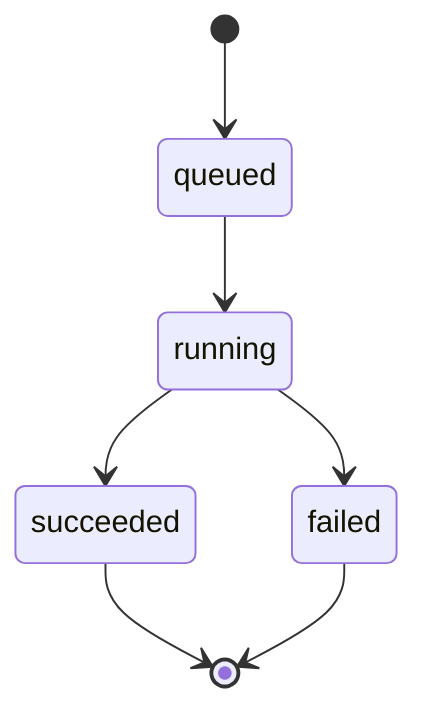

# Advanced Topics

## 1. Async jobs and polling

`POST /api/v1/projects/{project_id}/analyze` returns `202 Accepted` and creates three sequential jobs:

1. `extract_claims`: chunks ready documents into passages and extracts claims with exact `[char_start, char_end)` spans.
2. `retrieve`: embeds passages and claims (`BAAI/bge-small-en-v1.5`) and retrieves top-K candidates (`TOP_K`, default `5`).
3. `nli`: scores each `(passage, claim)` pair (`cross-encoder/nli-deberta-v3-xsmall`) with calibrated class priors (`entailment`, `contradiction`, `neutral`).



- Poll `GET /api/v1/projects/{project_id}/jobs` every 2-3 seconds while any job is `queued` or `running`.
- Calling `POST /analyze` while a run is active returns `409 Conflict` (`already_running`).
- Check `error_message` if a job enters `failed`.
- `?sync=true` runs inline and is meant for smoke tests and CLI scripts only.

## 2. Pagination

Collection endpoints use offset pagination and return `total`, `limit`, and `offset`:

| Endpoint | Query Parameters | Default `limit` | Max `limit` | Envelope |
|---|---|---:|---:|---|
| `GET /api/v1/projects` | `limit`, `offset` | 50 | 200 | `{ projects, total, limit, offset }` |
| `GET /api/v1/projects/{id}/documents` | `limit`, `offset` | 50 | 200 | `{ documents, total, limit, offset }` |
| `GET /api/v1/projects/{id}/claims` | `limit`, `offset`, `label`, `document_id`, `search` | 50 | 200 | `{ claims, total, limit, offset, jobs }` |

Values outside `limit` (`1..200`) or `offset` (`>= 0`) return `422 Unprocessable Entity` (`validation_error`).

## 3. Rate limiting

`POST /api/v1/projects/{id}/documents` and `POST /api/v1/projects/{id}/analyze` use a per-client sliding-window limiter keyed by `(user_id, client_ip)`:

- Default quota: `60 requests / 60 seconds` (`RATE_LIMIT_PER_MINUTE`).
- Response headers on allowed calls: `X-RateLimit-Limit`, `X-RateLimit-Remaining`.
- When exceeded: `429 Too Many Requests` with `Retry-After` (seconds) and:

```json
{
  "code": "rate_limited",
  "message": "Rate limit exceeded. Retry after 12 seconds.",
  "request_id": "a91f0c44-2c13-4b3b-86d0-8f0c8122f1aa"
}
```

Wait for `Retry-After` seconds before retrying.

## 4. Idempotency and deduplication

- Document uploads (`POST /documents`): SHA-256 hash is checked per project. Duplicate files return `409 Conflict` (`duplicate_file`) without creating extra files or passages.
- Label overrides (`PATCH /evidence/{id}`): idempotent; repeating the same payload produces the same state and never changes `model_label`.
- Project creation (`POST /projects`): rejects case-insensitive duplicate names per owner (`409 Conflict`, `duplicate_name`).

## 5. Request tracing and metrics

- `X-Request-ID`: if sent by the client, it is preserved; otherwise a UUIDv4 is generated. The value is returned in the response header, written to JSON logs, and included in `ErrorOut.request_id`.
- `GET /metrics`: Prometheus text metrics (`factmap_http_requests_total`, `factmap_http_request_duration_seconds`).

## 6. Versioning

- All business endpoints live under `/api/v1`.
- Breaking changes require a new major prefix (`/api/v2`).
- Additive changes (optional response fields, new query parameters with defaults, new routes) stay in `/api/v1` and are logged in [`../README.md#changelog`](../README.md#changelog).
