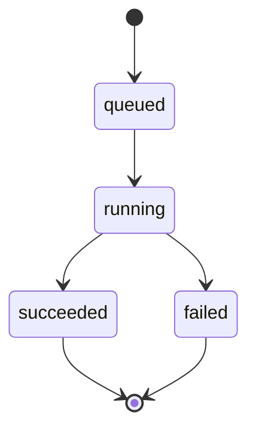

# Advanced API Design Topics

This guide covers production integration patterns for the FactMap Scholar API: asynchronous job polling, pagination, rate limiting, idempotency, distributed tracing, and versioning.

---

## 1. Asynchronous Job Execution & Polling

ML inference (claim extraction, dense embedding retrieval, and DeBERTa NLI cross-encoding) runs asynchronously in background workers to avoid HTTP timeouts.

### Stage Lifecycle
`POST /api/v1/projects/{project_id}/analyze` returns `202 Accepted` and enqueues three sequential jobs:

1. `extract_claims` — segments documents into passages and detects claim-worthy sentences with exact `[char_start, char_end)` spans.
2. `retrieve` — embeds passages and claims (`BAAI/bge-small-en-v1.5`) and retrieves Top-K candidates (`TOP_K`, default `5`).
3. `nli` — scores each `(passage, claim)` pair (`cross-encoder/nli-deberta-v3-xsmall`) with post-hoc calibrated class priors (`entailment`, `contradiction`, `neutral`).

### Job Status Transitions



### Polling Recommendations
- Poll `GET /api/v1/projects/{project_id}/jobs` every **2–3 seconds** while any job has `status` in `["queued", "running"]`.
- Avoid calling `POST /analyze` again while a run is active — the API enforces mutual exclusion per project and responds with `409 Conflict` (`already_running`).
- Check `error_message` whenever `status == "failed"`.
- Note: `?sync=true` executes inline and is strictly intended for automated tests and CLI scripts.

---

## 2. Pagination Strategy

All collection endpoints use **offset-based pagination** with explicit total counts:

| Endpoint | Query Parameters | Default `limit` | Max `limit` | Response Envelope |
|---|---|---:|---:|---|
| `GET /api/v1/projects` | `limit`, `offset` | `50` | `200` | `{ projects, total, limit, offset }` |
| `GET /api/v1/projects/{id}/documents` | `limit`, `offset` | `50` | `200` | `{ documents, total, limit, offset }` |
| `GET /api/v1/projects/{id}/claims` | `limit`, `offset`, `label`, `document_id`, `search` | `50` | `200` | `{ claims, total, limit, offset, jobs }` |

Requesting `limit < 1`, `limit > 200`, or `offset < 0` returns `422 Unprocessable Entity` (`validation_error`).

---

## 3. Rate Limiting (NFR-06)

Compute-intensive endpoints (`POST /api/v1/projects/{id}/documents` and `POST /api/v1/projects/{id}/analyze`) are protected by a per-client **sliding-window rate limiter** keyed by `(user_id, client_ip)`:

- **Default quota:** `60 requests / 60 seconds` (configurable via `RATE_LIMIT_PER_MINUTE`).
- **Response headers on allowed calls:**
  - `X-RateLimit-Limit: 60`
  - `X-RateLimit-Remaining: 59`
- **Behavior when exceeded:**
  - Status: `429 Too Many Requests`
  - Header: `Retry-After: <seconds>`
  - Body:
    ```json
    {
      "code": "rate_limited",
      "message": "Rate limit exceeded. Retry after 12 seconds.",
      "request_id": "a91f0c44-2c13-4b3b-86d0-8f0c8122f1aa"
    }
    ```
- **Client strategy:** Honor the `Retry-After` header with exponential jittered backoff rather than retrying immediately.

---

## 4. Idempotency & Deduplication

- **Document uploads (`POST /documents`):** Every uploaded payload is hashed with **SHA-256**. Re-uploading an identical file into the same project is rejected safely with `409 Conflict` (`duplicate_file`) without creating duplicate storage files or duplicate passages.
- **Label overrides (`PATCH /evidence/{id}`):** Fully idempotent — repeating the same `{"user_label": "contradiction"}` or `{"user_label": null}` produces the exact same state and preserves `model_label`.
- **Project creation (`POST /projects`):** Enforces case-insensitive per-owner uniqueness (`409 Conflict`, `duplicate_name`).

---

## 5. Request Tracing & Observability

- **Correlation ID (`X-Request-ID`):** Clients may pass an `X-Request-ID` header on any request; if omitted, the middleware generates a UUIDv4. The exact ID is echoed in the response `X-Request-ID` header, included in structured JSON server logs, and embedded inside every `ErrorOut.request_id` payload.
- **Prometheus Metrics (`GET /metrics`):** Exposes `factmap_http_requests_total` and `factmap_http_request_duration_seconds` histograms labeled by HTTP method, route template, and status code.

---

## 6. API Versioning Policy

- All business endpoints live under `/api/v1`.
- Breaking changes (removing fields, renaming keys, changing status semantics) require introducing `/api/v2`.
- Non-breaking additions (new optional fields, new filter query parameters, new endpoints) are released under `/api/v1` and documented in [`../README.md#changelog`](../README.md#changelog).
