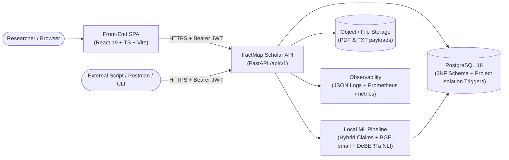
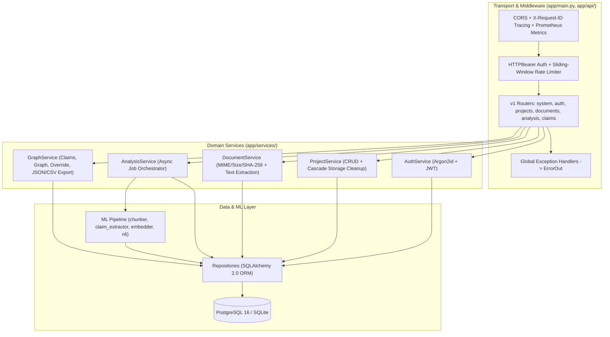
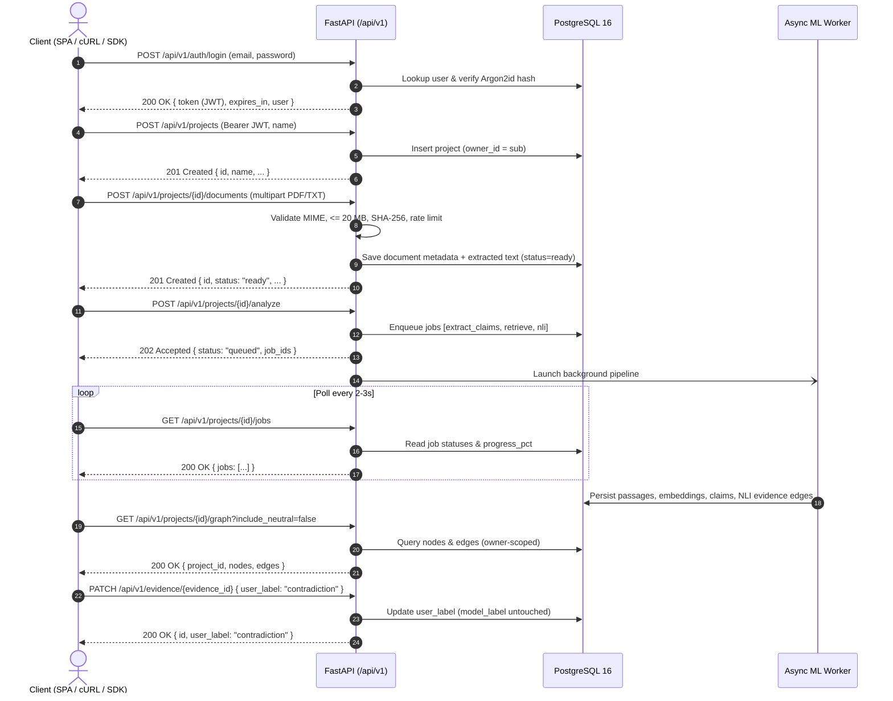

# API Architecture & Request Flows

This document explains how the FactMap Scholar API fits into the overall client–server system and details the layered backend architecture and asynchronous verification lifecycle.

---

## 1. System Context Diagram

---

## 2. Layered API Architecture

The backend (`backend/app/`) separates transport, domain orchestration, persistence, and ML execution cleanly:

---

## 3. End-to-End Request–Response Sequence Diagram

