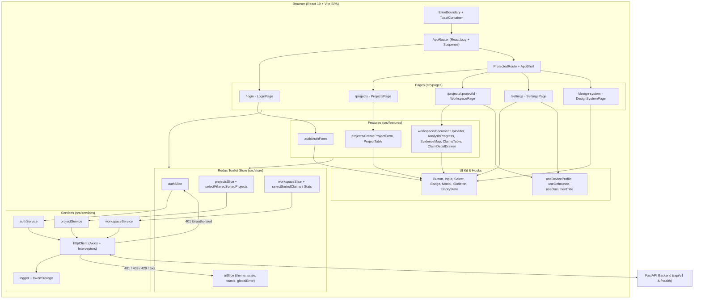
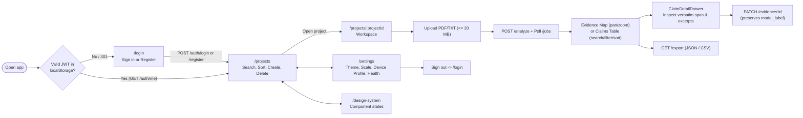

# Front-End Architecture

Source code: `frontend/`. Backend OpenAPI contract: [`docs/api/openapi.yaml`](../api/openapi.yaml).

## 1. Architecture approach

The client is a React 19 + TypeScript (`strict: true`) + Vite 8 SPA organized by feature modules with Redux Toolkit for shared state.

Folder layout under `frontend/src/`:

- `components/common/`: reusable UI primitives (`Button`, `Input`, `Select`, `Badge`, `Modal`, `Skeleton`, `EmptyState`, `ToastContainer`, `ErrorBoundary`).
- `components/layout/`: `AppShell` responsive frame (desktop sidebar, top bar, mobile bottom navigation, skip link).
- `features/`: domain modules (`auth/`, `projects/`, `workspace/`) containing forms, validation, sortable tables, file upload, pipeline progress, interactive SVG `EvidenceMap`, and `ClaimDetailDrawer`.
- `pages/` and `routes/`: 5 lazy-loaded pages (`LoginPage`, `ProjectsPage`, `WorkspacePage`, `SettingsPage`, `DesignSystemPage`) plus `NotFoundPage`, guarded by `ProtectedRoute`.
- `store/`: Redux Toolkit store split into 4 slices (`auth`, `projects`, `workspace`, `ui`) with async thunks and memoized `createSelector` queries. Transient form values, modal visibility, and SVG pan/zoom coordinates stay in local component state.
- `services/`: Axios instance (`httpClient.ts`) with JWT and `X-Request-ID` interceptors, error normalization, domain API wrappers (`authService`, `projectService`, `workspaceService`), `tokenStorage`, and `logger`.
- `models/`: TypeScript interfaces (`api.ts`, `ui.ts`) matching `backend/app/models/schemas.py`.
- `hooks/`: `useDeviceProfile`, `useDebounce`, `useDocumentTitle`.
- `styles/`: layered CSS files (`tokens.css`, `base.css`, `layout.css`, `components.css`, `workspace.css`).

## 2. Application architecture diagram



## 3. User flows and routing



| Route | Component | Access | Purpose |
|---|---|---|---|
| `/login` | `LoginPage` | Public | Sign-in and registration forms with validation |
| `/projects` | `ProjectsPage` | Protected | Project list/table, search, sorting, create and delete modals |
| `/projects/:projectId` | `WorkspacePage` | Protected | Uploads, pipeline progress polling, Evidence Map, Claims table, detail inspector, NLI overrides, export |
| `/settings` | `SettingsPage` | Protected | Light/dark theme, text scale (`0.9x`-`1.25x`), device profile, `/health` check |
| `/design-system` | `DesignSystemPage` | Protected | Component states and color contrast reference |
| `*` | `NotFoundPage` | Public | 404 fallback |

## 4. API integration and error handling

All HTTP calls go through `src/services/httpClient.ts` against `/api/v1` and `/health` (proxied to `http://127.0.0.1:8000` in dev, configured via `VITE_API_BASE_URL` in production). Full schemas are in [`docs/api/openapi.yaml`](../api/openapi.yaml).

| Method & Path | Service | Purpose |
|---|---|---|
| `POST /api/v1/auth/register` | `authService.register` | Register account and issue JWT |
| `POST /api/v1/auth/login` | `authService.login` | Authenticate user |
| `GET /api/v1/auth/me` | `authService.getMe` | Restore session on reload |
| `GET /api/v1/projects` | `projectService.listProjects` | List user projects |
| `POST /api/v1/projects` | `projectService.createProject` | Create workspace |
| `DELETE /api/v1/projects/{id}` | `projectService.deleteProject` | Cascade-delete project and files |
| `GET /api/v1/projects/{id}/documents` | `workspaceService.listDocuments` | List documents and extraction status |
| `POST /api/v1/projects/{id}/documents` | `workspaceService.uploadDocument` | Upload PDF/TXT (`<= 20 MB`) |
| `POST /api/v1/projects/{id}/analyze` | `workspaceService.startAnalysis` | Start async claim + retrieval + NLI run |
| `GET /api/v1/projects/{id}/jobs` | `workspaceService.listJobs` | Poll job status and progress |
| `GET /api/v1/projects/{id}/claims` | `workspaceService.listClaims` | Filtered/searchable claims with evidence |
| `GET /api/v1/projects/{id}/graph` | `workspaceService.getGraph` | Graph nodes and NLI edges |
| `PATCH /api/v1/evidence/{id}` | `workspaceService.overrideEvidenceLabel` | Override `user_label` (keeps `model_label`) |
| `GET /api/v1/projects/{id}/export` | `workspaceService.exportProject` | Download filtered JSON or CSV |
| `GET /health` | `workspaceService.getHealth` | Check API status and active models |

Example override request and response (`PATCH /api/v1/evidence/{evidence_id}`):

```json
// Request
{ "user_label": "contradiction" }

// Response (200 OK)
{ "id": "e4f2c1a0-8114-4d6b-9f12-2d1d6a1a4e09", "user_label": "contradiction" }
```

Error handling layers:

1. Axios response interceptor (`httpClient.ts`) converts backend `ErrorOut` payloads, HTTP status codes, and network failures into `ApiClientError`.
   - `401` (outside login/register): clears stored JWT, dispatches `logout()`, shows toast, redirects to `/login`.
   - `403`, `429`, `5xx`, network error: shows global error banner and toast with `request_id`.
   - `404`, `409`, `413`, `415`, `422`: rendered inline in the form or feature alert.
2. `ErrorBoundary` catches unexpected render exceptions, logs them via `logger.error`, and offers recovery controls.
3. Async views render `Skeleton` placeholders and button spinners (`aria-busy="true"`).

## 5. Tech stack rationale

| Tool | Alternatives | Reason for choice |
|---|---|---|
| React 19 + TypeScript (`strict`) | Angular, Vue 3 | Straightforward custom SVG graph rendering, strong typing matching FastAPI Pydantic models, no `any` allowed by ESLint. |
| Vite 8 | Webpack, CRA | Fast HMR, built-in dev proxy for `/api` and `/health`, automatic route chunking with `React.lazy`, shared config with Vitest. |
| Redux Toolkit | React Context only, MobX | Handles multi-step async workspace state (upload -> analyze -> poll -> refresh -> override) cleanly with `createAsyncThunk` and memoized selectors. |
| Axios | Raw `fetch` | Built-in request/response interceptors for Bearer JWT injection, `X-Request-ID`, timeouts, and centralized status code handling. |
| Vanilla CSS with custom properties | Bootstrap, Material UI | Direct control over light/dark tokens, WCAG 2.1 AA contrast, `rem`/`clamp()` scaling, and 44px touch targets with a small CSS bundle (~5 kB gzipped). |
| Lucide React | Icon fonts, raster assets | Tree-shaken inline SVGs that stay sharp at any DPR. |
| Vitest + Testing Library + Playwright | Jest, Cypress | Fast jsdom unit tests sharing Vite config plus real Chromium E2E and responsive layout checks. |

## 6. Performance, accessibility, and responsiveness

- All 5 routes are code-split via `React.lazy` + `Suspense`; `EvidenceMap` uses `React.memo`; derived lists and stats use `createSelector`.
- Semantic HTML landmarks, skip-to-content link, keyboard-accessible graph nodes (`tabIndex`, `Enter`/`Space`), ARIA live regions for alerts/toasts, `prefers-reduced-motion` support, and >=4.5:1 text contrast in both themes.
- `useDeviceProfile()` tracks breakpoint tier, viewport size, DPR, orientation, and aspect ratio. Desktop uses a left sidebar and split workspace; tablet and mobile switch to a bottom tab bar and card lists with >=44px touch targets.

## 7. Verification commands

From `frontend/`:

```bash
npm run lint          # ESLint
npm run format:check  # Prettier
npm run build         # tsc -b + vite build
npm run test          # 6 Vitest suites (17 tests)
npm run test:e2e      # Playwright Chromium E2E + adaptive suites (4 tests)
```
