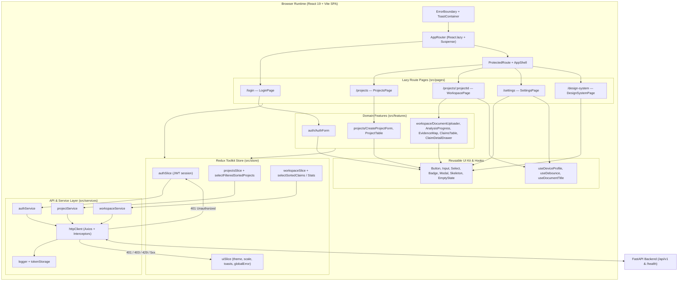
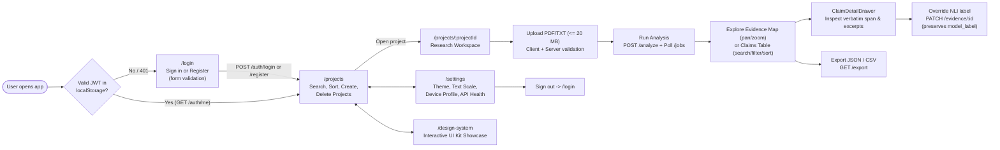

# FactMap Scholar — Front-End Architecture & Documentation

> Stage 3 Deliverable — **Front-End Architecture and Development** criterion  
> Application source: `frontend/` · OpenAPI contract: `docs/api/openapi.yaml`

---

## 1. Architecture Overview & Approach

FactMap Scholar's Front-End is a **Single Page Application (SPA)** built with **React 19, TypeScript (`strict: true`, zero `any`), Vite, and Redux Toolkit**.

The codebase follows a **Feature-Oriented Modular Architecture** combined with the **Unidirectional Data Flow (Flux / Redux Toolkit)** pattern:

- **Presentation layer (`src/components/`)** — Pure, reusable UI primitives (`Button`, `Input`, `Select`, `Badge`, `Modal`, `Skeleton`, `EmptyState`, `ToastContainer`, `ErrorBoundary`) and responsive layout shell (`AppShell`). Components receive typed props and emit callbacks without coupling directly to transport details.
- **Feature modules (`src/features/`)** — Domain-scoped interactive modules (`auth/`, `projects/`, `workspace/`) combining UI primitives with form validation, drag-and-drop upload rules, interactive SVG Evidence Map rendering, sortable tables, and researcher label overrides.
- **Pages & Lazy Routing (`src/pages/`, `src/routes/`)** — Five primary routes (`LoginPage`, `ProjectsPage`, `WorkspacePage`, `SettingsPage`, `DesignSystemPage`) plus a 404 fallback (`NotFoundPage`), each code-split with `React.lazy` + `Suspense` and guarded by `ProtectedRoute`.
- **Global & Local State (`src/store/`)** — Redux Toolkit store divided into four domain slices (`auth`, `projects`, `workspace`, `ui`) with async thunks (`createAsyncThunk`) and memoized selectors (`createSelector`). Transient form input, modal open state, and SVG pan/zoom transforms remain local React state to avoid unnecessary global re-renders.
- **API & Cross-Cutting Services (`src/services/`)** — Centralized Axios client (`httpClient.ts`) with request/response interceptors, `X-Request-ID` correlation headers, Bearer JWT injection, unified `NormalizedApiError` mapping (`401/403/404/409/413/415/422/429/500`), and structured logging (`logger.ts`).
- **Domain Models (`src/models/`)** — Strict TypeScript interfaces (`api.ts`, `ui.ts`) matching the FastAPI Pydantic schemas (`backend/app/models/schemas.py`) 1:1.
- **Design Token CSS Architecture (`src/styles/`)** — Layered Vanilla CSS (`tokens.css` → `base.css` → `layout.css` → `components.css` → `workspace.css`) implementing WCAG 2.1 AA light/dark themes, fluid typography (`rem`/`clamp()`), and responsive mobile/tablet/desktop/ultrawide layouts without ad-hoc inline styles.

---

## 2. Front-End Application Architecture Diagram



---

## 3. User Flows & Navigation Diagram



### Route Map

| Route | Component | Guard | Purpose |
|---|---|---|---|
| `/login` | `LoginPage` | Public | Controlled Sign-in & Register forms with validation |
| `/projects` | `ProjectsPage` | `ProtectedRoute` | Project table/cards, search, sorting, create & cascade-delete modals |
| `/projects/:projectId` | `WorkspacePage` | `ProtectedRoute` | Document upload, ML pipeline polling, interactive Evidence Map, Claims table, Detail inspector, NLI overrides, JSON/CSV export |
| `/settings` | `SettingsPage` | `ProtectedRoute` | Light/Dark theme, display scale (`0.9×–1.25×`), live device profile, backend `/health` check |
| `/design-system` | `DesignSystemPage` | `ProtectedRoute` | Interactive design kit documenting all UI states |
| `*` | `NotFoundPage` | Public | 404 fallback route |

---

## 4. API Integration Documentation

The Front-End communicates exclusively with the versioned REST API defined in [`docs/api/openapi.yaml`](../api/openapi.yaml) via `src/services/httpClient.ts`. During local development, Vite proxies `/api` and `/health` to `http://127.0.0.1:8000` (configurable via `VITE_API_BASE_URL` in `frontend/.env.example`).

### Endpoints Consumed

| Method & Path | Service Method | Purpose |
|---|---|---|
| `POST /api/v1/auth/register` | `authService.register` | Create researcher account and obtain Bearer JWT |
| `POST /api/v1/auth/login` | `authService.login` | Authenticate researcher account |
| `GET /api/v1/auth/me` | `authService.getMe` | Restore active user profile on page reload |
| `GET /api/v1/projects` | `projectService.listProjects` | Paginated list of user projects |
| `POST /api/v1/projects` | `projectService.createProject` | Create isolated project workspace |
| `DELETE /api/v1/projects/{id}` | `projectService.deleteProject` | Cascade-delete project and stored files |
| `GET /api/v1/projects/{id}/documents` | `workspaceService.listDocuments` | List uploaded papers and extraction statuses |
| `POST /api/v1/projects/{id}/documents` | `workspaceService.uploadDocument` | Multipart PDF/TXT upload (`<= 20 MB`) |
| `POST /api/v1/projects/{id}/analyze` | `workspaceService.startAnalysis` | Trigger asynchronous claim extraction + retrieval + NLI |
| `GET /api/v1/projects/{id}/jobs` | `workspaceService.listJobs` | Poll pipeline stage completion percentages |
| `GET /api/v1/projects/{id}/claims` | `workspaceService.listClaims` | Filtered/searchable extracted claims + evidence |
| `GET /api/v1/projects/{id}/graph` | `workspaceService.getGraph` | Typed nodes (`document`/`claim`/`passage`) & NLI edges |
| `PATCH /api/v1/evidence/{id}` | `workspaceService.overrideEvidenceLabel` | Set or clear researcher `user_label` (preserves `model_label`) |
| `GET /api/v1/projects/{id}/export` | `workspaceService.exportProject` | Download filtered JSON or CSV report |
| `GET /health` | `workspaceService.getHealth` | Check API version and active ML models |

### Request / Response Examples

**Override NLI Label (`PATCH /api/v1/evidence/{evidence_id}`):**
```json
// Request
{
  "user_label": "contradiction"
}

// Response (200 OK)
{
  "id": "e4f2c1a0-8114-4d6b-9f12-2d1d6a1a4e09",
  "user_label": "contradiction"
}
```

**Structured API Error (`401 / 403 / 404 / 409 / 413 / 415 / 422 / 429 / 500`):**
```json
{
  "code": "not_found",
  "message": "Project not found",
  "request_id": "f47ac10b-58cc-4372-a567-0e02b2c3d479"
}
```

### Global Error Handling Strategy

1. **Axios Response Interceptor (`src/services/httpClient.ts`)**:
   - Normalizes all backend `ErrorOut` responses, raw HTTP status codes, and network failures into `ApiClientError`.
   - `401 Unauthorized` (outside login/register): clears stored JWT, dispatches `logout()`, notifies the user via toast, and redirects to `/login`.
   - `403 Forbidden`, `429 Rate Limited`, `5xx Server Errors`, and network outages: triggers global error banner + toast notification with correlation `request_id`.
   - `404`, `409`, `413`, `415`, `422`: surfaced inline in the relevant form or feature alert banner.
2. **React Error Boundary (`src/components/common/ErrorBoundary.tsx`)**: catches unexpected render errors, logs component stack via `logger.error`, and offers recovery controls without crashing the entire browser tab.
3. **Loading States**: every async fetch uses `Skeleton` placeholders (`ProjectsPage`, `WorkspacePage`, `SettingsPage`, `ProtectedRoute`, `Suspense` fallback) and button spinners (`aria-busy="true"`).

---

## 5. Technology Stack Justification

| Choice | Alternatives Considered | Why Chosen for FactMap Scholar |
|---|---|---|
| **React 19 + TypeScript (`strict`)** | Angular, Vue 3 | Dominant ecosystem for custom interactive SVG visualizations, strict static typing guarantees 1:1 fidelity with FastAPI Pydantic schemas, and zero runtime `any` leaks. |
| **Vite 8** | Webpack, CRA | Sub-second HMR, native ESM dev proxy to FastAPI (`/api`, `/health`), automatic Rollup/Rolldown code splitting for `React.lazy` routes, and unified configuration with Vitest. |
| **Redux Toolkit (`@reduxjs/toolkit`)** | React Context only, MobX | Predictable Flux architecture for multi-stage async workflows (upload → analyze → poll jobs → refresh claims & graph → optimistic override), built-in Immer immutability, and memoized `createSelector` pipelines. |
| **Axios** | Raw `fetch` | Built-in request/response interceptor pipeline for JWT injection, `X-Request-ID` tracing, multipart upload headers, timeout enforcement, and centralized `401/403/429/5xx` handling. |
| **Vanilla CSS + Semantic Design Tokens** | Bootstrap, Material UI | Full control over scholarly editorial typography (`Newsreader` + `Plus Jakarta Sans` + `JetBrains Mono`), WCAG 2.1 AA light/dark contrast, `rem`/`clamp()` fluid scaling, `44px` touch targets, and minimal CSS bundle size (~4.8 kB gzipped). |
| **Lucide React** | Raster icons, FontAwesome | Crisp, tree-shaken inline SVG icons that scale cleanly across high-DPR displays and inherit theme colors. |
| **Vitest + React Testing Library + Playwright** | Jest, Cypress | Native Vite/ESM speed for unit/component tests (`jsdom`) paired with real Chromium E2E testing in Playwright. |

---

## 6. Performance, Accessibility & Adaptive UI

- **Code Splitting & Memoization**: All 5 application routes are lazy-loaded via `React.lazy` + `Suspense`; `EvidenceMap` is wrapped in `React.memo`; derived lists and statistics use memoized `createSelector` functions.
- **Accessibility (WCAG 2.1 AA)**: Semantic landmarks (`<header>`, `<aside>`, `<nav>`, `<main>`), skip-to-content link, keyboard-navigable graph nodes (`tabIndex`, `Enter`/`Space`), ARIA live regions for toasts and validation alerts, `>= 4.5:1` color contrast in both Light and Dark themes, and `prefers-reduced-motion` support.
- **Responsive & Mobile-First Adaptation**:
  - Automatic `useDeviceProfile()` hook tracks breakpoint (`mobile` / `tablet` / `desktop` / `ultrawide`), DPR, orientation, and aspect ratio.
  - Desktop uses a persistent sidebar and split Evidence Map + Claim Inspector workspace; tablet/mobile collapse to a one-hand fixed bottom navigation bar with safe-area insets and responsive card lists.
  - All interactive controls meet the `44px` minimum touch target size.

---

## 7. Verification & Testing

From `frontend/`:

```bash
npm run lint          # ESLint (zero warnings/errors, @typescript-eslint/no-explicit-any: error)
npm run format:check  # Prettier formatting check
npm run build         # TypeScript strict check (tsc -b) + Vite production bundle
npm run test          # 6 Vitest unit & component test suites (16 tests)
npm run test:e2e      # 2 Playwright Chromium E2E test suites
```
