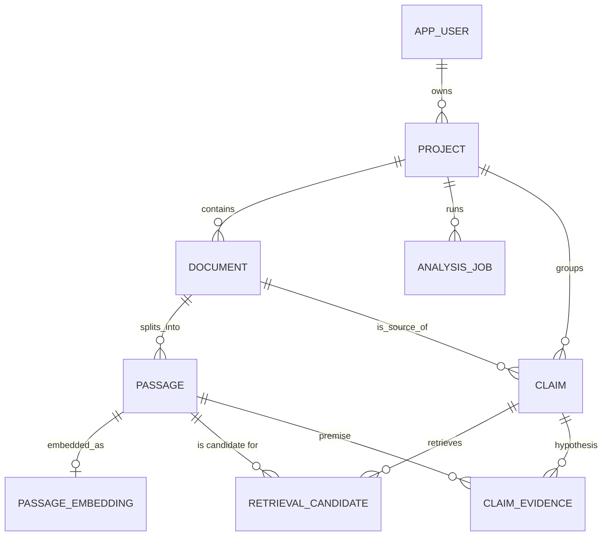

# Logical schema — FactMap Scholar

Relational model, third normal form. One fact lives in one place: a user, a project name, a file, a passage, a claim, a retrieval rank, an NLI label.

The evidence map is this graph, stored in tables:

- node **Document** — uploaded paper
- node **Claim** — statement taken from a span of one document
- node **Passage** — chunk that can support or contradict a claim, including a chunk from another paper in the same project
- edge **Claim evidence** — NLI label between a claim and a passage

## Why these entities

| Entity | Business rule |
|---|---|
| User | Work is private to the owner (US-11: no cross-user delete) |
| Project | Unique name per owner; deletion removes derived data |
| Document | PDF or TXT, ≤ 20 MB, status queued / processing / ready / failed |
| Analysis job | Visible progress; a failure stores a reason |
| Passage | Offset span plus text, so the UI can show the excerpt |
| Passage embedding | Retrieval vector, separated so the passage row stays the text |
| Claim | Always has a source document, a character span, and the extractor id. A trigger requires that document to sit in the same project |
| Retrieval candidate | At most one rank per claim; default product limit is 5 |
| Claim evidence | Three labels; model label is kept when the user overrides |

## Decisions an expert will look for

- Structure is created only by `ddl/001_init.sql`. Nothing is created by clicking in a GUI.
- Repeating groups are tables (`passage`, `retrieval_candidate`, `claim_evidence`), not arrays of JSON on `project`.
- `model_label` and `user_label` are separate columns, so an override does not destroy the model output (US-09).
- Cascade from `project` implements erasure (US-11). Application code still has to delete the object-storage files; the database does not hold those bytes.
- Triggers `trg_claim_same_project`, `trg_candidate_same_project`, and `trg_evidence_same_project` keep every claim, candidate, and NLI edge inside one project.
- Embeddings use `real[]` with a check that `dimensions = cardinality(vector)`. A later move to `pgvector` changes the column type only.
